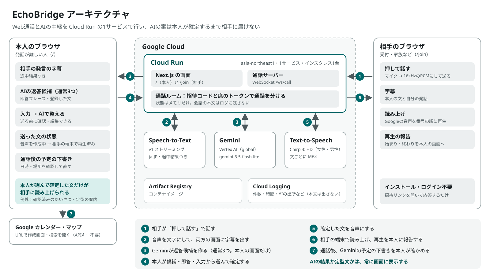

# EchoBridge

発話が難しい人が、ブラウザ同士のWeb通話で自分の意思を相手に伝えるための会話支援サービス。

相手の話は文字で受け取り、返したい文は返答候補・即答フレーズ・自分の入力から選ぶ。本人が確認した文だけを合成音声で相手に読み上げる（例外は、返事を待ってもらう定型の案内だけ）。

- 対象: 構音障害、吃音、喉頭摘出などで声で伝えるのが難しく、相手の声は聞き取れて文字を読める人
- 相手: 病院の受付、家族、知人、お店など。ブラウザで招待リンクを開くだけで参加できる（インストール・ログイン不要）
- 電話回線（PSTN）にはつながらない。Web通話で完結する
- 病院の予約はデモのシナリオの1つ。日常の連絡にも使える

## 公開版で試す

**https://echobridge-765277972072.asia-northeast1.run.app**

ブラウザを2つ使う（PCの2つのウィンドウ、またはPCとスマートフォン）。インストールとログインは不要。**架空の内容だけで試し、実在の個人情報は話さない。**

1. 本人の画面（上のURL）で「例を入力」→「発信する」
2. 表示された招待リンクを、別のウィンドウかスマートフォンのブラウザで開く（相手の画面）→「応答する」。あいさつが読み上げられる
3. 相手の画面で「押して話す」を押し、たとえば「明日の午後2時半はいかがですか」と話して、もう一度押す（初回はマイクの許可が必要）
4. 本人の画面に相手の発言とAIの返答候補が出る。候補・即答フレーズ・入力から選ぶと、相手の画面で読み上げられる
5. 本人の画面で「通話を終了」→ 会話から読み取った予定の下書きを確かめ、「Google カレンダーに追加」

- 相手の画面のマイクは、Safari・Chromeなどのブラウザで使う。LINEなどのアプリ内のブラウザでは使えないことがある
- 音声はスピーカーから出るので、1台のPCで試すときは音量に注意する

## 使い方の流れ

| | 本人（`/`） | 相手（`/join`） |
|---|---|---|
| 1 | 通話の目的（医療機関／日常の連絡）、相手の名前、最初に伝える用件を入れる。読み上げるあいさつを確認して発信 | |
| 2 | 招待リンクかコードを相手に送る | リンクを開く（またはコードを入力）→ 応答 |
| 3 | | あいさつが合成音声で流れる |
| 4 | | 「押して話す」で話す（タップで開始・もう一度で送信、長押しでも可） |
| 5 | 相手の話が文字で届き、AIの返答候補が出る（通常3つ） | 自分の話した内容が字幕に出る |
| 6 | 候補・即答フレーズ・登録した文・入力（AIで整えて確認）から返す | 本人が確定した文が読み上げられる |
| 7 | どちらかが通話を終える。会話から読み取った予定の下書きを直し、場所はGoogleマップで確かめて、Googleカレンダーの作成画面へ | |

## 機能

| 機能 | 使う技術 | 状態 |
|---|---|---|
| 招待リンク・コードでの参加、通話の分離、再接続 | WebSocket（`ws`） | 実装済み |
| 相手の発話の文字起こし（途中結果つき） | Cloud Speech-to-Text v1 ストリーミング | 実装済み・実APIで確認 |
| 返答候補（通常3つ。会話にない数字を含む候補は出さない）、文の整形、通話後の予定の読み取り | Vertex AI の Gemini（`gemini-3.5-flash-lite`） | 実装済み・実APIで確認 |
| AIが使えないときの定型文と出所の表示 | — | 実装済み |
| 即答フレーズ（AIを待たずに送る） | — | 実装済み |
| 登録した文（自己紹介などを本人が登録し、表示どおりに送る。端末のブラウザにだけ保存） | `localStorage` | 実装済み |
| 本人が確定した文の読み上げ（女性・男性の声を選べる）、音声の作成と再生の状態の報告、読み直し | Cloud Text-to-Speech（Chirp 3: HD、ja-JP）。使えないときは相手の端末の日本語の声（`speechSynthesis`） | 実装済み・実APIとPCのブラウザで確認（スマートフォン実機は未確認） |
| 予定の下書きとGoogleカレンダーへの追加 | カレンダーの予定作成URL（APIは使わない） | 実装済み |
| 予定の場所をGoogleマップで確かめる、自分の予定をGoogleカレンダーで見る | Maps URLs、カレンダーのURL（APIキー不要） | 実装済み |

詳細と検証状況は [docs/FEATURES.md](docs/FEATURES.md)。

## 構成



- 画面: Next.js 16（App Router）、React 19、Tailwind CSS 4。`src/app/page.tsx`（本人）、`src/app/join/page.tsx`（相手）
- サーバー: Node.js の `http` と `ws`。`server/index.ts` が起動し、通話の処理は `server/callServer.ts` と `server/callRoom.ts`
- AI: `@google/genai` で Vertex AI の Gemini を呼ぶ（`server/geminiClient.ts`、プロンプトは `server/geminiService.ts`）
- 文字起こし: `@google-cloud/speech`（`server/speechRecognizer.ts`）
- 通話の状態はサーバーのメモリだけに置く。データベースは使わず、通話本文をログに出さない

## すぐに試す（Windows）

リポジトリのフォルダで、次のファイルをダブルクリックする。

| ファイル | 内容 |
|---|---|
| `setup.bat` | Node.js の確認と依存関係のインストール（最初に1回） |
| `start-mock.bat` | **モックモード**で起動。Google Cloudの認証がなくても通話の流れを試せる。AIと文字起こしは台本で、画面に「モック（開発用）」と出る |
| `start-local.bat` | 実際の Gemini と Speech-to-Text を使って起動（下の認証と `.env` が必要。料金がかかる） |
| `check.bat` | テスト・build・型検査・lint をまとめて実行 |

起動すると `http://localhost:3000/` が開く。本人の画面で発信し、表示された招待リンクを別のウィンドウで開くと相手として参加できる。2人で試す手順とシナリオは [docs/TESTING.md](docs/TESTING.md)。

Windows以外では `node scripts/dev.mjs setup|mock|local|check` で同じことができる。手動で起動する場合は `npm run dev`（画面、3000番）と `npm run server`（通話、8080番）を別々に動かす。

## 認証と環境変数

ローカルで実APIを使うときは、ADC（アプリケーションのデフォルト認証情報）で認証する。鍵ファイルは作らない。

```bash
gcloud auth application-default login
```

```bash
gcloud auth application-default set-quota-project <プロジェクトID>
```

リポジトリ直下に `.env` を作る（コミットしない。`.gitignore` 済み）。

```text
GOOGLE_GENAI_USE_VERTEXAI=true
GOOGLE_CLOUD_PROJECT=<プロジェクトID>
GOOGLE_CLOUD_LOCATION=global
```

`server/` が読む環境変数:

| 変数 | 用途 | 既定値 |
|---|---|---|
| `GOOGLE_GENAI_USE_VERTEXAI` | `true` でVertex AIを使う（本番の想定） | なし |
| `GOOGLE_CLOUD_PROJECT` | Vertex AIのプロジェクトID | なし |
| `GOOGLE_CLOUD_LOCATION` | Vertex AIのロケーション | `global` |
| `GEMINI_API_KEY` | Gemini Developer APIキー（ローカル検証用。Vertex AIの指定があれば使わない） | なし |
| `GEMINI_MODEL` | 使うモデル。変えるときは公式の退役日を確認する | `gemini-3.5-flash-lite` |
| `GEMINI_TIMEOUT_MS` | 返答候補と文の整形を待つ上限（ミリ秒） | `8000` |
| `GEMINI_EXTRACTION_TIMEOUT_MS` | 通話後の予定の読み取りを待つ上限（ミリ秒） | `20000` |
| `GEMINI_MAX_REQUESTS_PER_MINUTE` | サーバー全体でGeminiへ送る依頼の上限（1分あたり）。超えた分は定型文として明示して返す | `60` |
| `STT_MAX_CONCURRENT_STREAMS` | 同時に録音できる数（STTの課金の上限） | `3` |
| `TTS_ENABLED` | `false` でCloud Text-to-Speechを使わず、相手の端末の声で読む | 使う |
| `TTS_VOICE_FEMALE` / `TTS_VOICE_MALE` | 本人が選ぶ「女性の声」「男性の声」の実際の声 | `ja-JP-Chirp3-HD-Aoede` / `ja-JP-Chirp3-HD-Charon` |
| `TTS_SPEAKING_RATE` | 話す速さ（0.25〜2.0） | `1` |
| `TTS_DAILY_CHAR_LIMIT` | 1日（日本時間）に合成する文字数の上限。超えた分は相手の端末の声で読む | `50000` |
| `TTS_API_ENDPOINT` | Text-to-Speechの接続先を変えるとき（地域のエンドポイントなど） | 既定（global） |
| `PORT` | サーバーのポート。Cloud Runが設定する | `8080` |
| `ALLOWED_ORIGINS` | 同一オリジンのほかに接続を許可するオリジン（カンマ区切り） | 開発時は `http://localhost:3000` と `http://127.0.0.1:3000`、本番はなし |
| `NEXT_PUBLIC_WS_URL` | 通話サーバーの接続先（ビルド時に埋め込み）。別サービスに分けるときだけ指定 | 同一オリジン（開発時は同じホストの8080番） |

## テスト

```bash
npm test
```

```bash
npm run test:live
```

`npm test` は認証なしで動く（STTとGeminiは偽物）。`npm run test:live` は実際のGeminiを呼ぶので、上の認証と課金が必要。認証がないと「未確認」として失敗する。詳細は [docs/TESTING.md](docs/TESTING.md)。

## Cloud Run

本番（`NODE_ENV=production`）では `npm start`（`server/index.ts`）が画面と通話のWebSocketを同じポートで配る。コンテナは `Dockerfile` で作り、認証はCloud Runのサービスアカウント（ADC）を使う。鍵や `.env` はイメージに入れない。

| 設定 | 値 | 理由 |
|---|---|---|
| `--max-instances` | `1` | 通話の状態をインスタンス間で共有していないため |
| `--min`（サービス単位） | `1` | 待機中も1台を残し、最初の表示を待たせない（0のときは初回の表示に約7秒かかった） |
| `--timeout` | `3600` | 既定の5分でWebSocketが切れるため。切れても自動で再接続する |
| `--concurrency` | `200` | WebSocket 1本が同時リクエスト1件に数えられるため |

| 必要なもの | 内容 |
|---|---|
| API | Cloud Run Admin API、Artifact Registry API、Vertex AI API、Cloud Speech-to-Text API、Cloud Text-to-Speech API |
| 実行用サービスアカウント | `roles/aiplatform.user`（Gemini） |
| 公開 | `--no-invoker-iam-check`、または `allUsers` への `roles/run.invoker`（Cloud Run管理者の権限が必要） |
| 環境変数 | `GOOGLE_GENAI_USE_VERTEXAI=true`、`GOOGLE_CLOUD_PROJECT`、`GOOGLE_CLOUD_LOCATION` |

インスタンスが入れ替わると通話中の状態は消え、画面に「通話が見つかりません」と出る。SIGTERMを受けると通話中の画面に終了を知らせてから止まる。通話に入っていない接続は10分で閉じ、操作があればつなぎ直す（開いたままのタブで課金が続かないように）。

ローカルで本番の構成を試す場合:

```bash
npm run build
```

```bash
NODE_ENV=production npm start
```

## 制約と今後

- 通話の状態はメモリだけ。複数インスタンスにするには Memorystore や Firestore で共有が必要
- 読み上げは文ごとの一括合成（MP3）。長い文ほど音声が届くまで時間がかかる（実測 18文字0.6秒、40文字1.3秒。あいさつは相手の着信中に作る）
- Cloud Text-to-Speech が使えないときの端末の声は、日本語の声がない端末では使わない（字幕だけになる）
- 相手の画面のマイクはHTTPS（またはlocalhost）でしか使えない
- 予定はカレンダーの作成画面を開くだけで、本人の予定は読まない（空き時間の確認は検討中）
- 対応言語は日本語だけ

今後の候補と判断材料は [docs/FEATURES.md](docs/FEATURES.md) の「今後の拡張」。

## ライセンス

[MIT License](LICENSE)。使っているライブラリ・フォント・Google Cloudのサービスは、それぞれのライセンスと利用規約に従う。
